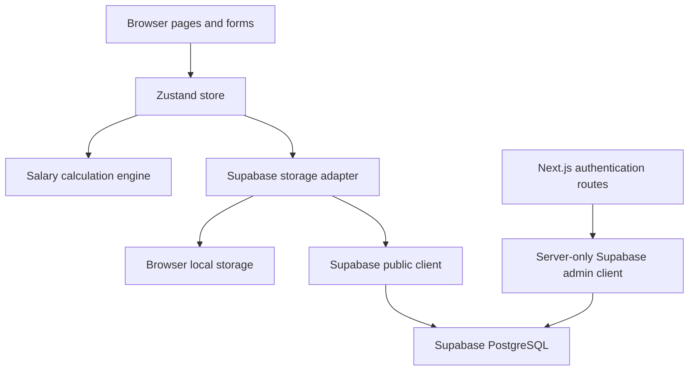

# System architecture

The app combines a Next.js interface, a client-side calculation engine, Zustand state, and Supabase-backed authentication and persistence. Some persistence paths still fall back to browser storage or in-memory values.

## Runtime components

| Layer                 | Implementation                             |
| --------------------- | ------------------------------------------ |
| Web app               | Next.js 14 App Router and React 18         |
| UI state              | Zustand store in `src/lib/store/`          |
| Calculations          | `src/lib/calculation/salaryEngine.ts`      |
| Browser persistence   | Supabase client and local storage adapter  |
| Server authentication | Next.js route handlers and `supabaseAdmin` |
| Database              | Supabase PostgreSQL                        |
| Hosting               | Vercel                                     |

## Data flow

The calculation endpoint at `POST /api/calculate` calls the calculation engine and returns derived values. It does not persist data.

## Authentication routes

Email/password and LINE LIFF flows are implemented through separate route and client paths. Server routes use a signed application session cookie. The browser Supabase client also exists, but its Auth state is not the same as the custom application cookie.

Protect production session cookies with a unique `SESSION_SECRET`. The current session module has a source-code fallback; see [environment setup](../developer/environment-setup.md).

## Database boundary and production status

The schema setup script enables RLS and grants table access only to `service_role`. It inserts no rows and creates no public-user policies. The browser adapter still performs direct table queries with the public key, so those operations will fail against this secure setup.

Admin and authentication routes must also use the server-only client consistently. Do not treat this architecture as production-ready for real contractor data until all sensitive operations pass through authenticated server handlers and authorization tests.

## Database entities

The setup script defines eight tables: `users`, `contractors`, `agencies`, `contracts`, `monthly_periods`, `system_options`, `system_settings`, and `audit_logs`. See [database schema](../database/schema.md) for relationships and access behavior.

## Document output

The app renders document previews in the browser and uses browser print styles. The five document views cover delivery, receipts, workload, attendance, and contract summaries.
