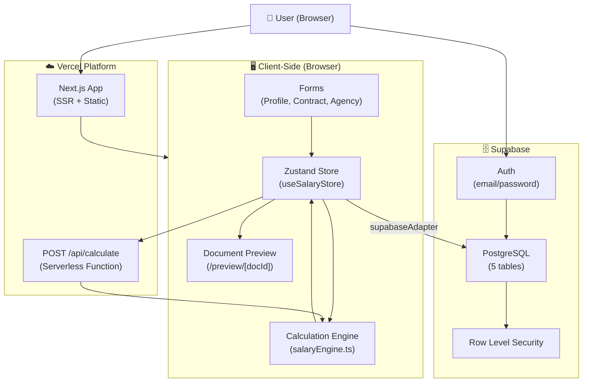
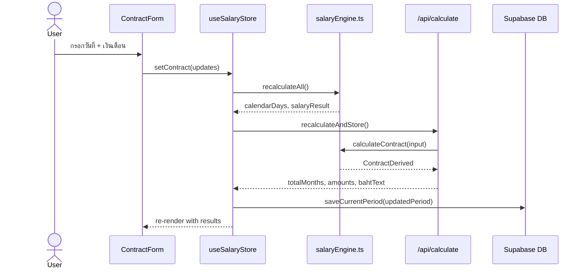
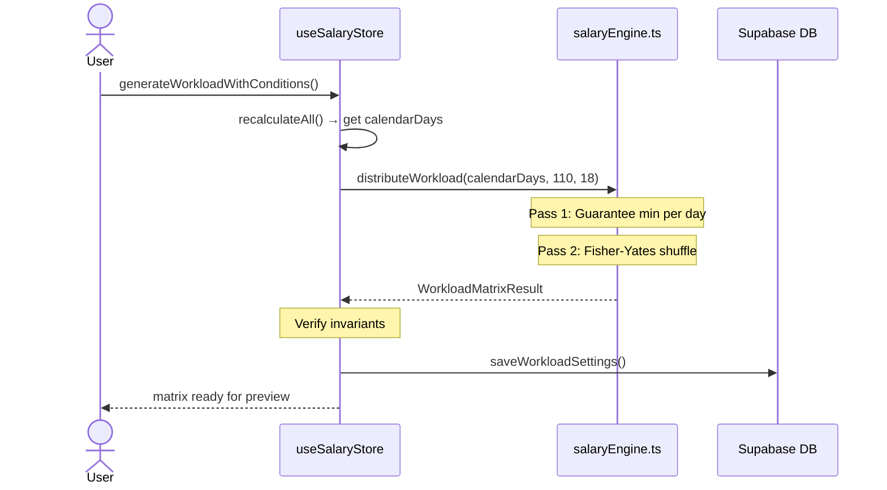

# System Architecture Overview — salary-doc-web

> ภาพรวมสถาปัตยกรรมระบบ, data flow, และการตัดสินใจทางเทคนิค

---

## 🏗️ Tech Stack

| Layer | เทคโนโลยี | เหตุผล |
|---|---|---|
| **Frontend Framework** | Next.js 14 (App Router) | SSR, file-based routing, API routes ในที่เดียว |
| **UI Components** | React 18 + Tailwind CSS | reactive UI, utility-first CSS |
| **State Management** | Zustand | lightweight, TypeScript-friendly |
| **Database** | Supabase (PostgreSQL) | realtime, auth built-in, RLS |
| **Hosting** | Vercel | zero-config Next.js deployment |
| **Language** | TypeScript | type safety |
| **Icons** | Lucide React | consistent icon set |

---

## 🗺️ System Architecture Diagram



---

## 📊 Data Flow: การคำนวณเงินเดือน



---

## 📊 Data Flow: การสร้างภาระงาน (Workload Matrix)



---

## 🧩 Layer Architecture

```
┌─────────────────────────────────────────────────────────┐
│                    Presentation Layer                   │
│   Next.js Pages  │  React Components  │  Print Preview  │
├─────────────────────────────────────────────────────────┤
│                    State Layer                          │
│            useSalaryStore (Zustand)                     │
├─────────────────────────────────────────────────────────┤
│                    Business Logic                       │
│   salaryEngine.ts  │  distributeWorkload  │  bahtText   │
├─────────────────────────────────────────────────────────┤
│                    Data Access Layer                    │
│   supabaseAdapter  │  storageAdapter (localStorage)     │
├─────────────────────────────────────────────────────────┤
│                    Infrastructure                       │
│      Supabase DB   │  Vercel Serverless   │  Auth       │
└─────────────────────────────────────────────────────────┘
```

---

## 🔄 State Management Architecture

### Zustand Store Slices (ใน `useSalaryStore.ts`)

```
AppState
├── contractor: ContractorProfile      ← ข้อมูลผู้รับจ้าง
├── agency: AgencyProfile             ← ข้อมูลหน่วยงาน
├── contract: ContractDetails         ← ข้อมูลสัญญา
├── currentPeriod: MonthlyPeriod      ← งวดปัจจุบัน
├── workloadSettings: WorkloadSettings ← การตั้งค่า matrix
├── auditLogs: AuditLogEntry[]        ← ประวัติการเปลี่ยนแปลง
│
├── [Computed]
│   ├── calendarDays: CalendarDay[]   ← สร้างจาก recalculateAll()
│   ├── workloadResult: WorkloadMatrixResult
│   ├── attendanceRecords: AttendanceRecord[]
│   └── salaryResult: SalaryCalculationResult
│
└── [UI State]
    ├── activeDocument: DocumentType
    ├── selectedPeriodNumber: number
    ├── isCalculating: boolean
    ├── isLoading: boolean
    └── isHydrated: boolean
```

### Auto-Sync Chain

```
User Action (e.g., setContract)
    ↓
Zustand State Update
    ↓
supabaseAdapter.save*()  ← async, fire-and-forget
    ↓
recalculateAll()         ← synchronous
    ↓
generateWorkloadWithConditions()
    ↓
generateAttendance()
```

---

## 🗓️ Calendar & Working Day Logic

```
For each day in month:
    isWeekend = (dayOfWeek === 0 || 6)
    isHoliday = public_holidays.includes(day)
    isAbsent  = absent_days.includes(day)
    
    is_working_day = !isWeekend && !isHoliday && !isAbsent
    
    cell_color:
        weekend/holiday → '#D3D3D3'
        absent → white (แต่ถูกหักเงิน)
        working → '#FFFFFF'
```

---

## 📐 Workload Matrix Algorithm

```
Input: calendarDays[], targetTasks=110, taskCount=18

Step 1: Filter working day indices
Step 2: Pass 1 — Guarantee minTasksPerDay on each working day
Step 3: Pass 2 — Fisher-Yates shuffle remaining capacity pool
Step 4: Fill until grand_total === targetTasks

Invariants enforced:
✓ Non-working cells = 0 (strictly)
✓ Binary values only (0 or 1)
✓ grand_total === targetTasks
✓ Deterministic with fixed seed
```

---

## 🔐 Security Architecture

```
Browser Request
    ↓
Vercel Edge (HTTPS)
    ↓
Next.js Middleware (requireAuth.ts)
    ↓
API Route / Page
    ↓
Supabase Client (anon key)
    ↓
PostgreSQL
    ↓
Row Level Security (RLS)
    ↓
user_id = auth.uid() check
```

### Auth Flow

```
User → Login page
    → Supabase Auth (email/password)
    → JWT session stored in secure cookie
    → requireAuth.ts validates on each protected route
```

---

## 📄 Document Generation Architecture

```
User selects document type (DOC-01 ~ DOC-05)
    ↓
useSalaryStore provides all data
    ↓
/preview/[docId]/page.tsx
    ↓
Renders HTML with:
    - Thai numerals (DOC-01)
    - Arabic numerals (DOC-02)
    - Workload matrix table (DOC-03)
    - Attendance records (DOC-04)
    - Contract summary (DOC-05)
    ↓
window.print() → Browser print dialog
    ↓
CSS @media print rules apply
    ↓
TH Sarabun font for government documents
```

---

## 🚀 Performance Considerations

| ด้าน | กลยุทธ์ |
|---|---|
| **Initial Load** | Static generation สำหรับหน้าที่ไม่มี auth |
| **Calculation** | Synchronous, client-side (no network roundtrip) |
| **State Persistence** | Async fire-and-forget ไม่บล็อก UI |
| **Matrix Generation** | Deterministic seed = reproducible results |
| **Print Preview** | Pure HTML/CSS (ไม่ใช้ PDF library) |

---

## 🔗 ลิงก์ที่เกี่ยวข้อง

- [Database Schema](../database/schema.md)
- [API Reference](../api/calculate-endpoint.md)
- [Developer Guide](../developer/getting-started.md)
- [Agent Rules](../agent/AGENTS.md)
