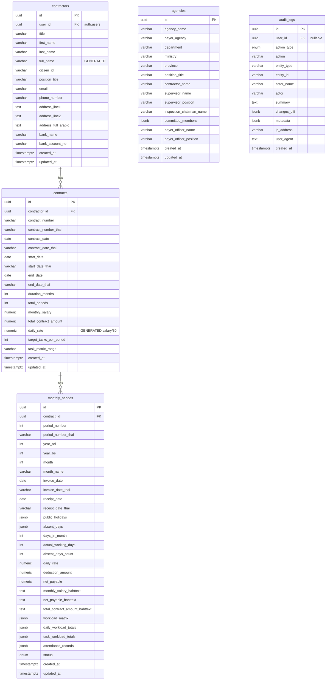

# Database Schema — salary-doc-web

> โครงสร้างฐานข้อมูล Supabase (PostgreSQL) สำหรับระบบเอกสารสัญญาจ้าง

**Migration file:** [`supabase/migrations/20261102000000_init_schema.sql`](../../supabase/migrations/20261102000000_init_schema.sql)

---

## Entity Relationship Diagram



---

## ตารางข้อมูล (Tables)

### 1. `contractors` — ข้อมูลผู้รับจ้าง

| Column | Type | Nullable | Default | หมายเหตุ |
|---|---|---|---|---|
| `id` | UUID | NO | `gen_random_uuid()` | PK |
| `user_id` | UUID | YES | — | FK → auth.users |
| `title` | VARCHAR(50) | NO | `'นาย'` | คำนำหน้า |
| `first_name` | VARCHAR(100) | NO | — | ชื่อ |
| `last_name` | VARCHAR(100) | NO | — | นามสกุล |
| `full_name` | VARCHAR(255) | GENERATED | — | title+first+last (STORED) |
| `citizen_id` | VARCHAR(13) | YES | — | เลขบัตร 13 หลัก |
| `position_title` | VARCHAR(255) | NO | `'จ้างเหมาบริการ...'` | ตำแหน่ง |
| `bank_name` | VARCHAR(100) | YES | `'ธนาคารกรุงไทย'` | |
| `bank_account_no` | VARCHAR(50) | YES | `'123-4-56789-0'` | |
| `created_at` | TIMESTAMPTZ | NO | `NOW()` | |
| `updated_at` | TIMESTAMPTZ | NO | `NOW()` | auto-update trigger |

**Seed Data (UUID: 00000000-0000-0000-0000-000000000001):**  
นาย[ชื่อผู้รับจ้าง] [นามสกุล]

---

### 2. `agencies` — ข้อมูลหน่วยงาน

| Column | Type | หมายเหตุ |
|---|---|---|
| `agency_name` | VARCHAR(255) | ชื่อหน่วยงาน |
| `payer_agency` | VARCHAR(255) | หน่วยงานจ่ายเงิน |
| `department` | VARCHAR(255) | สังกัด |
| `ministry` | VARCHAR(255) | กระทรวง |
| `contractor_name` | VARCHAR(255) | ชื่อผู้รับจ้าง (sync จาก contractor) |
| `supervisor_name` | VARCHAR(255) | ชื่อผู้ควบคุมงาน |
| `committee_members` | JSONB | คณะกรรมการตรวจรับ |

---

### 3. `contracts` — ข้อมูลสัญญา

| Column | Type | หมายเหตุ |
|---|---|---|
| `contract_number` | VARCHAR(50) | เลขที่สัญญา: `2/2570` |
| `contract_number_thai` | VARCHAR(50) | เลขที่ไทย: `๒/๒๕๗๐` |
| `monthly_salary` | NUMERIC(12,2) | เงินเดือน: `19800.00` |
| `total_contract_amount` | NUMERIC(12,2) | มูลค่าสัญญา: `237600.00` |
| `daily_rate` | NUMERIC(10,2) | **GENERATED**: `ROUND(monthly_salary / 30.0, 2)` |
| `target_tasks_per_period` | INT | จำนวนชิ้นงาน: `110` |
| `task_matrix_range` | VARCHAR(50) | ช่วง Excel: `C4:AG21` |

**Constraint:** `end_date >= start_date`

---

### 4. `monthly_periods` — ข้อมูลรายงวด

| Column | Type | หมายเหตุ |
|---|---|---|
| `period_number` | INT | งวดที่ 1-12 |
| `public_holidays` | JSONB | วันหยุด: `[13, 23]` |
| `absent_days` | JSONB | วันลา: `[]` |
| `workload_matrix` | JSONB | ตาราง matrix 18×31 |
| `attendance_records` | JSONB | บันทึกเวลาเข้า-ออก |
| `status` | ENUM | `draft` / `calculated` / `finalized` |
| `deduction_amount` | NUMERIC(10,2) | ยอดหัก |
| `net_payable` | NUMERIC(12,2) | เงินที่จ่ายจริง |

**Unique Constraint:** `(contract_id, period_number)` — ห้ามซ้ำ

---

### 5. `audit_logs` — บันทึกการเปลี่ยนแปลง (Immutable)

| Column | Type | หมายเหตุ |
|---|---|---|
| `action_type` | ENUM | ดูรายการด้านล่าง |
| `entity_type` | VARCHAR | `contractor`, `contract`, `period`, `workload` |
| `summary` | TEXT | คำอธิบายการกระทำ |
| `metadata` | JSONB | ข้อมูลเพิ่มเติม |

**Action Types:**  
`PROFILE_UPDATE`, `AGENCY_UPDATE`, `CONTRACT_UPDATE`, `PERIOD_UPDATE`,  
`WORKLOAD_GENERATE`, `ATTENDANCE_GENERATE`, `DOCUMENT_PREVIEW`,  
`DOCUMENT_PRINT`, `DATA_RESET`, `DATA_EXPORT`, `DATA_IMPORT`

> [!IMPORTANT]
> `audit_logs` เป็น **immutable** — RLS ปิด UPDATE โดย policy  
> (`audit_logs_no_update` ใช้ `USING (false)`)

---

## Enums

```sql
-- Audit action types
CREATE TYPE audit_action_type AS ENUM (
  'PROFILE_UPDATE', 'AGENCY_UPDATE', 'CONTRACT_UPDATE', 'PERIOD_UPDATE',
  'WORKLOAD_GENERATE', 'WORKLOAD_GENERATED', 'ATTENDANCE_GENERATE', 'ATTENDANCE_GENERATED',
  'DOCUMENT_PREVIEW', 'DOCUMENT_PRINT', 'DATA_RESET',
  'DATA_EXPORT', 'DATA_IMPORT', 'DATA_IMPORTED'
);

-- Period status
CREATE TYPE period_status_type AS ENUM ('draft', 'calculated', 'finalized');
```

---

## Indexes

| Index | ตาราง | Columns | ประเภท |
|---|---|---|---|
| `idx_contractors_user_id` | contractors | user_id | B-tree |
| `idx_contracts_contractor_id` | contracts | contractor_id | B-tree |
| `idx_monthly_periods_year_month` | monthly_periods | year_ad, month | B-tree |
| `idx_audit_logs_created_at_desc` | audit_logs | created_at DESC | B-tree |
| `idx_audit_logs_diff_gin` | audit_logs | changes_diff | GIN |
| `idx_audit_logs_metadata_gin` | audit_logs | metadata | GIN |

---

## Row Level Security (RLS)

| ตาราง | Policy | ผล |
|---|---|---|
| `contractors` | authenticated SELECT | user_id IS NULL OR user_id = auth.uid() |
| `contractors` | anon SELECT | ทุกแถว |
| `agencies` | anon/authenticated | ทุกแถว (public reference data) |
| `contracts` | anon/authenticated SELECT | ทุกแถว |
| `monthly_periods` | anon/authenticated | ทุกแถว |
| `audit_logs` | UPDATE | **ปิดทุกคน** (immutable) |

---

## Views

```sql
-- Backward compatibility view
CREATE VIEW profiles WITH (security_invoker = true) AS
  SELECT * FROM contractors;
```

---

## Seed Data

| ตาราง | UUID | ข้อมูล |
|---|---|---|
| contractors | `...0001` | นาย[ชื่อผู้รับจ้าง] [นามสกุล] |
| agencies | `...0002` | วิทยาลัยนักบริหารสาธารณสุข |
| contracts | `...0003` | สัญญา 2/2570 |
| monthly_periods | `...0004` | งวดที่ 1 — ตุลาคม 2569 |
